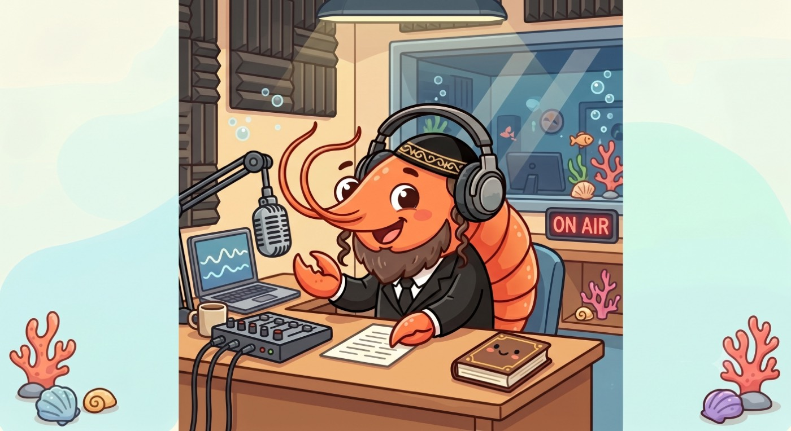

  

  <strong>Radio Vainer · 99.1</strong> 
  A one-person station. Live from the desk.

The picture on the site is the booth: one host, a microphone, music on the desk, and the On Air light. The pages are that booth. Warm paper, amber buttons, a small mark of the same picture beside the title.

The studio tab mixes the microphone with music playing on this computer and sends that mix straight to whoever is listening. The picture from screen share is never sent. Listeners only hear the show.

**Listen:** https://yanivvi.github.io/radio-vainer/

**Studio:** https://yanivvi.github.io/radio-vainer/studio.html

## The booth

GitHub Pages only serves the files. There is no media server. The open studio tab is the mixer and the broadcaster. Leave it up on the computer that has the microphone.

Listeners and a guest caller join the same room, `live`, through [Trystero](https://github.com/dmotz/trystero) on Nostr (`js/config.js`). Nostr is how the browsers find each other. The audio is a direct WebRTC connection to the studio tab. Each listener connects to the studio, not to the other listeners.

The studio builds one mix and sends that stream out:

- **Microphone** goes to the listeners and to the guest.
- **Music** is whatever you share from the screen or a tab. The video track stays on only so the browser keeps the capture. It is never played or sent.
- **Guest** audio joins the show for listeners. The caller hears the mix without their own voice, the way a booth feed works.

A full fade from one end of a slider to the other takes about three seconds. The microphone sits a little hotter than the music. Levels can go past 100.

Keep a single studio tab live. Listeners lock onto the first studio they hear.

## On the air

Use Chrome or Edge on the computer that has the microphone and the music.

1. Open the studio.
2. Turn on the microphone.
3. Capture music. Choose **Entire Screen** and turn on **Share system audio**. If the music is a browser tab, share that tab and its audio instead.
4. Go live. The badge turns from Off air to Live.
5. Leave the studio tab open and the computer awake. While the tab is visible, the page asks the screen to stay on.

Listeners open the radio page and press Listen. Sound starts only after that press. A small audience is the comfortable range, because each person connects directly to the studio tab. Someone who cannot make that direct connection hears nothing.

The **Message** line is the host's line on the radio page, and the lock-screen title. The studio repeats it every few seconds while live.

## Speak, Play, and Auto

These sit under the microphone and music faders, for ducking the bed when the host talks.

- **Speak** fades the music out and the microphone in. It turns the microphone on if it was off.
- **Play** fades the microphone out and the music in.
- **Auto** listens to the microphone before the fader, so it still hears you after Play has ducked the mic. A short stretch of voice runs Speak. Two seconds of quiet, long enough for a breath, runs Play.

Dragging a fader by hand stops the fade that was in progress.

Music has to be captured before Speak will move it. Play brings the music back only when a capture is active.

## The caller

**Guest** in the studio makes a one-time link (`guest.html?call=…`). Send it to one person. They open it, enter a name, and press Call in. They connect once the studio is live.

The caller hears the station without their own microphone. Listeners hear the caller through the guest fader. **Drop caller** ends that call. A new **Guest** press replaces the link.

## The remote

The phone cannot capture the music. The laptop stays the booth. **Remote** in the studio makes a one-time link (`remote.html#…`). Open it on the phone.

The phone joins a private room that listeners are not in, so a listener cannot move the faders. It can go live, stop, move the microphone, music, and guest levels, run Speak, Play, and Auto, edit the message, and drop the caller. Meters and the listener count come from the laptop. Starting the music capture stays on the laptop, because the browser only shows that share dialog there. The phone can fade that music and stop it.

Refreshing the studio tab keeps the same link. A new **Remote** press replaces it. Keep that tab open. While the link is up, or the station is live, the page asks the screen to stay on.

## The room

Listeners pick a name and a picture, then talk. The name Studio is reserved. The studio relays every message, and a person who joins receives the recent log, up to 40 messages. Join and leave lines show in the studio. Messages stay once they are sent. Chat is open only while the On Air light is on.

## The pages

| Page | On the desk |
| --- | --- |
| `index.html` | The radio. The mark, Listen, the host's line, and chat. |
| `studio.html` | The mix, the broadcast, the guest link, the remote link, and chat. |
| `guest.html` | One caller, opened from the studio link. The full booth picture. |
| `remote.html` | The phone booth. Faders and the message, aimed at the laptop. |
| `logo.jpg` | The host at the desk. Shown large on the caller page, small beside the titles. |
| `js/config.js` | Shared room id and Trystero options. |
| `js/deck.js` | The remote link's code and private room id. |
| `js/studio.js` | Mix, fades, broadcast, the caller, and the remote. |
| `js/listen.js` | Listener playback. |
| `js/guest.js` | Caller playback and microphone. |
| `js/remote.js` | Remote commands. The studio is the one that mixes. |
| `js/chat.js` | Chat for the radio page and the studio. |

`extension/` was built to fill a Now Playing field from the tab that is playing audio. The studio no longer has that field, so the extension does nothing.
